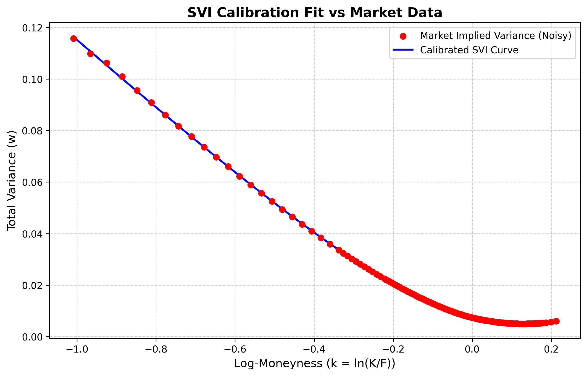
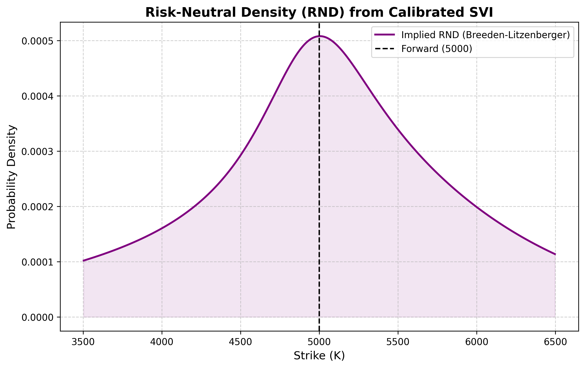
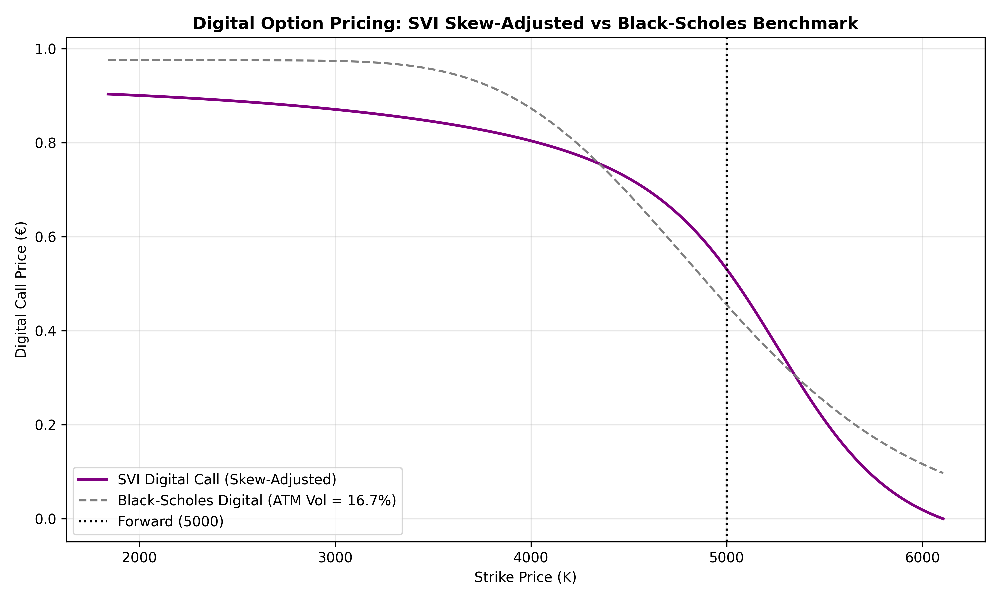

# SVI Calibration of the Euro Stoxx 50 Implied Volatility Smile and Risk-Neutral Density Extraction

## Abstract

The raw SVI (Stochastic Volatility Inspired) parametrization of Gatheral (2004) is calibrated to a single maturity of Euro Stoxx 50 ($\text{SX5E}$) options, expiring on 19 February 2027, using a Bloomberg `OMON` snapshot. The sample comprises 136 strikes retained after the liquidity filters of Section 3, spanning $k \in [-1.0, 0.2]$ in log-moneyness. The forward price and the discount factor are estimated from put–call parity. The parameters are estimated by multi-start SLSQP (Sequential Least Squares Programming), minimizing the mean squared error between market and model total implied variance; the resulting $\text{MSE}$ is $2.75 \times 10^{-8}$, corresponding to an RMSE of approximately 5 basis points in implied volatility. The risk-neutral density is obtained from the model-implied call prices through the Breeden–Litzenberger relation. It is non-negative on the evaluation grid, consistent with the absence of butterfly arbitrage over the calibrated range. As an application, the calibrated density is used to price a cash-or-nothing digital call: relative to a flat-volatility Black–Scholes benchmark, the at-the-money price is higher by $0.0757$ EUR ($0.5296$ vs. $0.4539$ EUR), rising to a maximum difference of approximately $0.11$ EUR in the downside region of the strike grid, consistent with the calibrated negative skew ($\rho = -0.65$).

---

## Mathematical Formulation

### 1. Raw SVI parametrization

Let $F$ be the forward price for maturity $T$, $k = \ln(K/F)$ the log-moneyness, and $\sigma_{\text{imp}}(k,T)$ the Black–Scholes implied volatility. The total implied variance is

$$w(k) = \sigma_{\text{imp}}^2(k,T)\, T .$$

For a fixed maturity, the raw SVI parametrization specifies

$$w(k;\chi) = a + b\left(\rho\,(k-m) + \sqrt{(k-m)^2 + \sigma^2}\right), \qquad \chi = (a, b, \rho, m, \sigma).$$

* $a \in \mathbb{R}$: vertical translation, setting the overall variance level.
* $b \ge 0$: scale of the wing slopes, which equal $b(1+\rho)$ as $k \to +\infty$ and $-b(1-\rho)$ as $k \to -\infty$.
* $\rho \in (-1,1)$: rotation of the smile, hence its skew.
* $m \in \mathbb{R}$: horizontal translation.
* $\sigma > 0$: curvature of $w$ at the vertex.

The constraints $b \ge 0$, $|\rho| < 1$, $\sigma > 0$ and $a + b\sigma\sqrt{1-\rho^2} \ge 0$ guarantee that $w(k;\chi)$ is well defined and non-negative, since $a + b\sigma\sqrt{1-\rho^2}$ is its minimum over $k$. They do not exclude butterfly arbitrage, which is assessed through the density in Section 2.

### 2. Risk-neutral density and butterfly arbitrage

Let $q$ denote the density of $S_T$ under the risk-neutral measure $\mathbb{Q}$. The price of a European call is

$$C(K,T) = e^{-rT}\int_K^\infty (s-K)\, q(s)\, ds .$$

Differentiating twice with respect to $K$ gives the Breeden–Litzenberger identity

$$q(K) = e^{rT}\,\frac{\partial^2 C(K,T)}{\partial K^2} .$$

Define, for a twice-differentiable $w(k) > 0$,

$$g(k) = \left(1 - \frac{k\,w'(k)}{2\,w(k)}\right)^2 - \frac{w'(k)^2}{4}\left(\frac{1}{w(k)} + \frac{1}{4}\right) + \frac{w''(k)}{2}.$$

The density of $\ln(S_T/F)$ under $\mathbb{Q}$ is

$$p(k) = \frac{g(k)}{\sqrt{2\pi\, w(k)}}\, \exp\!\left(-\frac{d_-(k)^2}{2}\right), \qquad d_-(k) = -\frac{k}{\sqrt{w(k)}} - \frac{\sqrt{w(k)}}{2},$$

with $q(K) = p(k)/K$. Since the exponential factor is positive, $p(k) \ge 0$ if and only if $g(k) \ge 0$. Following Gatheral and Jacquier (2014), a slice is free of butterfly arbitrage if and only if $g(k) \ge 0$ for all $k \in \mathbb{R}$ and $\lim_{k \to +\infty} d_+(k) = -\infty$, where $d_+(k) = -k/\sqrt{w(k)} + \sqrt{w(k)}/2$.

### 3. Data and pre-processing

The dataset is a single cross-section of Euro Stoxx 50 ($\text{SX5E}$) European options expiring on 19 February 2027, obtained from a Bloomberg `OMON` snapshot. Quotes with a zero bid or a zero ask price are discarded, including for deep out-of-the-money contracts; the most extreme retained strike corresponds to $k \approx -1.0$. Mid-prices are computed as the arithmetic average of bid and ask. This filtering yields 136 strikes, spanning $k \in [-1.0, 0.2]$.

The forward price $F$ and the rate $r$ (encompassing the implied funding rate and the continuous dividend yield) are estimated by ordinary least squares regression of $C(K,T) - P(K,T)$ on $K$, over strikes within $\pm 5\%$ of the spot level — the forward is not yet known at this stage, so the window is anchored on the observable spot price rather than on $F$ itself:

$$C(K,T) - P(K,T) = e^{-rT}(F - K).$$

The regression slope gives $-e^{-rT}$ and the intercept $e^{-rT}F$, from which $F$ and $e^{-rT}$ are recovered jointly, without reference to an external yield curve or dividend estimate.

### 4. Calibration and results

The parameters $\chi = (a,b,\rho,m,\sigma)$ are calibrated by minimizing the unweighted mean squared error between market and model total variance,

$$\min_{\chi} \frac{1}{N}\sum_{i=1}^N \left(w_{\text{mkt}}(k_i) - w(k_i;\chi)\right)^2, \qquad N = 136,$$

subject to $b \ge 0$, $|\rho| < 1$, $\sigma > 0$, and $a + b\sigma\sqrt{1-\rho^2} \ge 0$. The objective is non-convex in $\chi$; a multi-start SLSQP procedure, with initial points drawn within the parameter bounds, is used to reduce the risk of reporting a local minimum. The calibration attains $\text{MSE} = 2.75 \times 10^{-8}$ in total-variance units, corresponding to an RMSE of approximately 5 basis points in implied volatility.

The function $g(k)$ defined in Section 2 is evaluated analytically from the closed-form first and second derivatives of the calibrated $w(k;\chi)$. On the grid $k \in [-1.0, 0.2]$, $\min_k g(k) = 1.02 \times 10^{-4} > 0$, attained at the left boundary $k \approx -1.0$, consistent with the absence of butterfly arbitrage over the evaluated range. Because the minimum occurs at the edge of the domain rather than in its interior, $g(k)$ for $k < -1.0$ is not constrained by this result and could fall below zero; this does not constitute a proof of no-arbitrage for $k$ outside $[-1.0, 0.2]$.

Given the restriction to a single maturity, calendar-spread arbitrage is not assessed, and the asymptotic wing-slope bounds of Lee's moment formula are not imposed as explicit constraints.

### 5. Application: skew-adjusted digital option pricing

Consider a European digital (cash-or-nothing) call paying 1 EUR at $T$ if $S_T > K$, and zero otherwise. Under the risk-neutral measure $\mathbb{Q}$, its value is the discounted probability of finishing in-the-money,

$$V_{\text{digital}}(K) = e^{-rT}\,\mathbb{Q}(S_T > K) = e^{-rT}\int_K^{\infty} q(s)\,ds.$$

A static replication via a tight call spread, or a first-order Vega correction $V_{\text{digital}}^{\text{BS}}(K) - \text{Vega}(K)\cdot\partial\sigma/\partial K$, would approximate this value; here the integral is evaluated directly against the density $q(s)$ of Section 2, by the composite trapezoidal rule, truncated at $K_{\max} = Fe^{0.2} \approx 6107$ — the upper edge of the calibrated domain. This isolates the effect of the skew on the price rather than providing an independent check of it.

As a benchmark, $V_{\text{digital}}^{\text{BS}}(K) = e^{-rT}N(d_2(K))$ is computed under a single flat volatility $\sigma_{\text{ATM}} = \sqrt{w(0)/T}$, the SVI-implied at-the-money level, applied uniformly across all strikes.

At $K = F$, $V_{\text{digital}}(F) = 0.5296$ EUR against $V_{\text{digital}}^{\text{BS}}(F) = 0.4539$ EUR, a difference of $0.0757$ EUR. The maximum absolute difference across the evaluated strike grid is approximately $0.11$ EUR, in the downside region $K \in [4000, 4500]$.

The difference reflects the extent to which the SVI-implied density departs from the lognormal density of constant-volatility Black–Scholes, jointly in skewness and tail weight. It is consistent with the calibrated correlation parameter $\rho = -0.65$: since $\mathbb{E}^{\mathbb{Q}}[S_T] = F$ by construction, and a left-skewed unimodal distribution typically has its median above its mean, the heavier left tail raises $\mathbb{Q}(S_T > F)$ above $1/2$, increasing the ATM digital price relative to the symmetric Black–Scholes benchmark.

**SVI Calibration Fit vs Market Data**

**Risk-Neutral Density (Breeden–Litzenberger)**

**Digital Option Pricing Comparison**

### 6. Repository structure

* `data/`: `implied_vols.csv`, the cleaned and filtered implied-volatility chain used in Sections 3–5. The raw Bloomberg export is not included (see Reproducibility).
* `src/`: data cleaning (`01b_clean_bloomberg.py`), implied volatility calculation (`02_implied_volatility.py`), SVI calibration (`03_svi_calibration.py`), density extraction (`04_risk_neutral_density.py`), digital pricing (`05_digital_pricing.py`).
* `figures/`: output plots for the calibration fit, the risk-neutral density, and the digital pricing comparison.

### 7. Reproducibility

The project requires Python 3.10+ and `numpy`, `pandas`, `scipy`, `matplotlib`.

1. Clone the repository and install the dependencies listed in `requirements.txt`.
2. Run `02_implied_volatility.py` through `05_digital_pricing.py` sequentially, starting from the provided `data/implied_vols.csv`. Reproducing the cleaning step itself (`01b_clean_bloomberg.py`) requires a Bloomberg terminal with access to `OMON`.
3. SLSQP is a deterministic local optimizer; randomness enters only through the generation of the multi-start initial points — 100 points, drawn uniformly at random within the parameter bounds. Given the bounds, the calibrated $\chi$ is stable across different random seeds.

### 8. Limitations and extensions

* **Single maturity.** As noted in Section 4, the calibration does not assess calendar-spread arbitrage across expiries.
* **Asymptotic wings.** As noted in Section 4, the wing-slope bounds of Lee's moment formula are not imposed as explicit constraints.
* **Interest rate.** $r$ is a single effective rate recovered from put–call parity (Section 3), not decomposed into a risk-free rate and a dividend yield. Yield-curve bootstrapping is left for future work.
* **Tail truncation.** The digital prices of Section 5 omit the probability mass beyond $K_{\max}$, a fixed downward bias common to all strikes on the grid.

### References

* Breeden, D. T., & Litzenberger, R. H. (1978). *Prices of State-Contingent Claims Implicit in Option Prices*. Journal of Business, 51(4), 621–651.
* Gatheral, J. (2004). *A Parsimonious Arbitrage-Free Implied Volatility Parameterization with Application to the Valuation of Volatility Derivatives*. Presentation at Global Derivatives & Risk Management, Madrid.
* Gatheral, J., & Jacquier, A. (2014). *Arbitrage-Free SVI Volatility Surfaces*. Quantitative Finance, 14(1), 59–71.